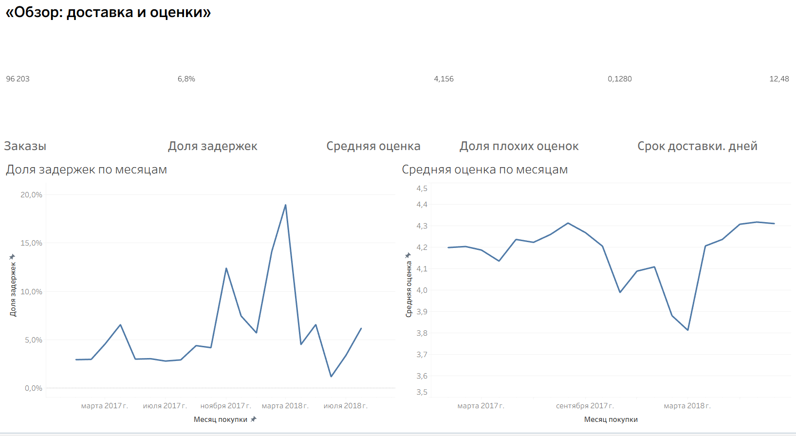

# Brazilian E-Commerce: Влияние задержек доставки на оценки и удержание клиентов

> 📄 **[Читать краткие выводы для бизнеса (Executive Summary)](EXECUTIVE_SUMMARY.md)**

Аналитический проект по исследованию влияния задержек доставки на удовлетворённость клиентов, повторные покупки и финансовые показатели маркетплейса **Olist** (Бразилия, 2017–2018 гг.).

---

##  Бизнес-проблема

Olist — крупнейший бразильский маркетплейс. Задержки доставки могут снижать оценки клиентов, уменьшать повторные покупки и наносить репутационный ущерб. Цель проекта — **количественно оценить этот эффект** и найти корневые причины задержек.

**Главный вопрос:** Как задержки доставки влияют на оценки клиентов и повторные покупки, и сколько выручки на этом теряется?

**Подвопросы:**
1. Какая доля заказов приходит позже обещанной даты и как это меняется по времени, регионам и категориям?
2. Как задержка влияет на оценку в отзыве (`review_score`)?
3. Возвращаются ли клиенты после плохого опыта реже, чем после хорошего?
4. Сколько выручки связано с проблемными заказами и какой эффект даст улучшение?

---

## 📊 Ключевые результаты

### 1. Задержка катастрофически снижает оценку заказа
- Доля плохих оценок (1–2 звезды) при задержке: **62,4%** против **9,3%** при доставке вовремя
- После контроля месяца, расстояния, штата и стоимости заказа: отношение шансов = **14,8** (95% ДИ [14,0; 15,7])
- Клиенты не прощают даже небольшие опоздания: при задержке 4–7 дней доля плохих оценок превышает **67%**
- Влияют **оба фактора**: и скорость доставки, и нарушение обещания. При одинаковом сроке опоздавшие заказы получают оценки ниже на 0,4–1,8 балла

### 2. Прямые потери от недополученных повторных покупок невелики
- Базовый уровень возврата клиентов за 180 дней: всего **~2%**
- Задержка первого заказа снижает возврат на **~0,43 п.п.** (с 2,01% до 1,58%), но эффект **статистически не подтверждён** (p = 0,062, мощность теста недостаточна)
- Прямая потеря выручки: **~2 757 R$** (~0,03% от выручки когорты)
- **Вывод:** основной ущерб — репутационный, а не прямой отток существующих клиентов

### 3. Корневая причина — системные логистические сбои, а не продавцы
- **87%** дополнительного времени при задержке приходится на этап транспортировки, лишь 13% — на обработку продавцом
- Главный проблемный маршрут: **SP → RJ** (Сан-Паулу → Рио-де-Жанейро) — **17,6%** всех опоздавших заказов при том, что Рио ближе к Сан-Паулу, чем другие штаты
- Три крупных всплеска задержек (ноябрь 2017, февраль–март 2018) связаны с замедлением доставки на маршрутах дальше 116 км, а не с изменением обещаний
- Продавцы вносят вклад (нарушение срока передачи втрое повышает риск опоздания), но не являются главной причиной

### 4. Обещанный срок — эффективный рычаг управления
- Увеличение обещания на 3 дня снижает формальные задержки с 6,8% до 4,8%, на 7 дней — до 3,0%
- Однако серьёзные сбои (опоздание 8+ дней) остаются проблемой логистики даже при длинных обещаниях (~44% нынешних опоздавших)
- Декабрь 2017: удлинение обещания на 5 дней при той же скорости снизило задержки с 12,4% до 7,5%

---

## 🧪 Гипотезы и результаты проверки

| Гипотеза | Статус | Ключевой результат |
|----------|--------|-------------------|
| **H1:** чем больше задержка, тем ниже оценка | ✅ **Подтверждена** | Отношение шансов плохой оценки при задержке = 14,8 (p < 0,001) |
| **H2:** плохая оценка → реже возврат | ⚠️ **Слабая** | Разность 0,38 п.п., p ≈ 0,03 (после поправки Холма ≈ 0,06) |
| **H3:** задержка первого заказа → реже возврат | ❌ **Не подтверждена** | Разность 0,43 п.п., p = 0,062, мощность недостаточна |

---

## 📊 Дашборд
  
*Интерактивная версия: [Доставка и оценки.twbx](dashboard/dashboards/Доставка%20и%20оценки.twbx)*

## 🔬 Методология

- **SQL-витрины** (DuckDB) с архитектурой `raw → staging → marts`
- **Статистические тесты** с доверительными интервалами (метод Уилсона, Ньюкомб)
- **Логистические и линейные регрессии** с робастными стандартными ошибками (HC1) для контроля искажающих факторов
- **Поправка Холма** на множественные сравнения
- **Анализ мощности** для оценки надёжности выводов по H3
- **Когортный анализ** с окном наблюдения 180 дней
- **Стратификация** по тяжести задержки (1–3, 4–7, 8+ дней)

---

## 🛠 Стек технологий

| Компонент | Технология |
|-----------|-----------|
| База данных | DuckDB |
| Язык запросов | SQL |
| Статистический анализ | Python (pandas, statsmodels, scipy) |
| Визуализация | Tableau Public |
| Управление версиями | Git |

---

## 📁 Структура проекта

```text
Brazzilian E-commerce Public Dataset by Olist/
├── EXECUTIVE_SUMMARY.md          # Краткие выводы для бизнеса
├── README.md                     # Этот файл
├── .gitignore
── requirements.txt
├── analysis/                     # Python-скрипты анализа
│   ├── 05_statistics.py          # Простые статистические тесты
│   ├── 06_regression.py          # Регрессионный анализ
│   ├── 07_robustness.py          # Проверка устойчивости
│   └── 08_charts.py              # Визуализации
├── assets/                       # Графики и изображения
│   ├── fig1_score_by_delay.png
│   ├── fig2_promise_vs_actual.png
│   ├── fig3_late_by_distance.png
│   └── fig4_h3_robustness.png
├── dashboard/                    # Tableau-дашборд
│   └── dashboards/Доставка и оценки.twbx
├── data/                         # Исходные данные Olist
│   ├── olist_orders_dataset.csv
│   ├── olist_customers_dataset.csv
│   └── ...
├── docs/                         # Документация и отчёты
│   ├── 00_problem_statement.md   # Постановка задачи и метрики
│   ├── 01_data_quality.md        # Отчёт о качестве данных
│   ├── sql_findings.md           # SQL-находки и витрины
│   └── statistic_findings.md     # Статистический анализ
── scripts/                      # Вспомогательные утилиты
│   ├── run_sql.py
│   ├── csv_to_xlsx.py
│   ── stats_helpers.py
└── sql/                          # SQL-скрипты построения витрин
    ├── 01_raw/
    ├── 02_staging/
    ├── 03_marts/
    └── 04_export/
```

---

## 🚀 Как запустить

### 1. Установка зависимостей
```bash
pip install -r requirements.txt